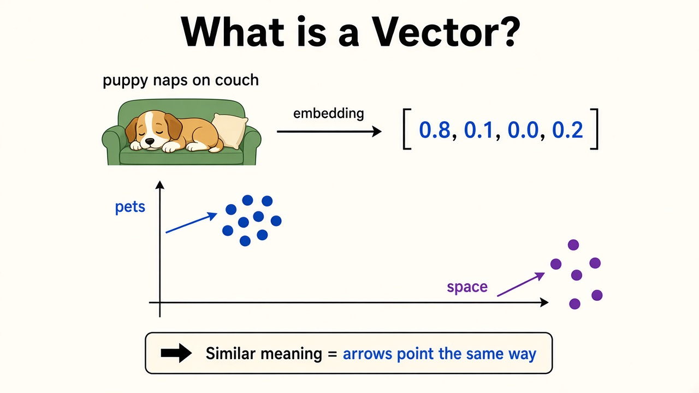
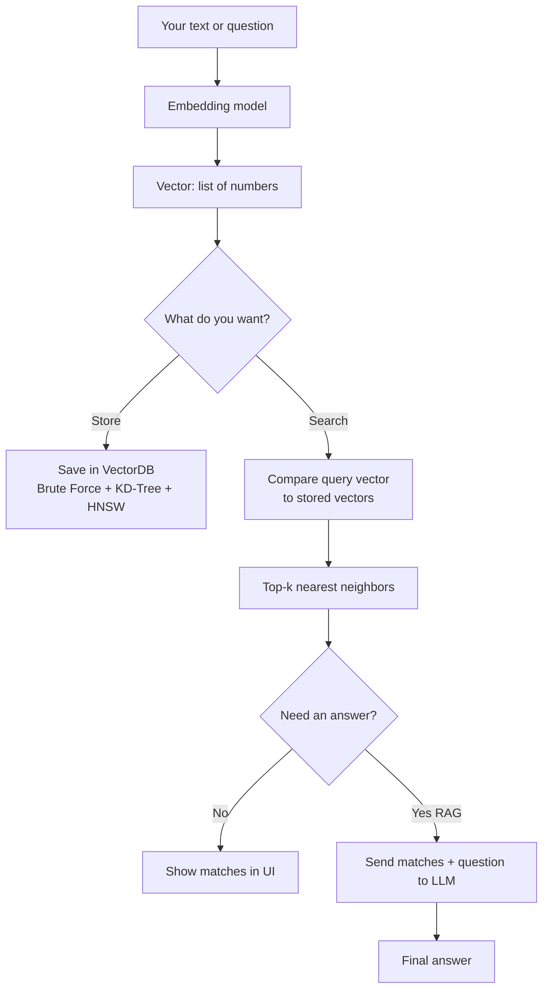
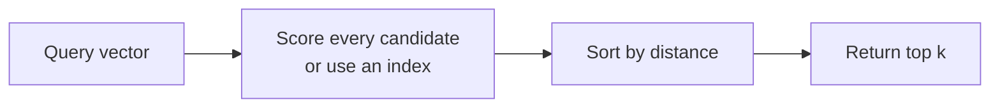
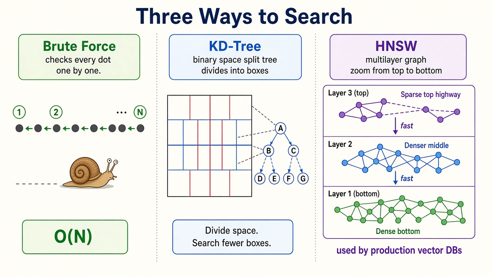
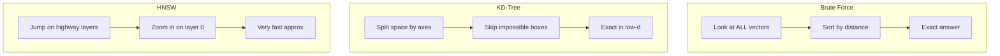
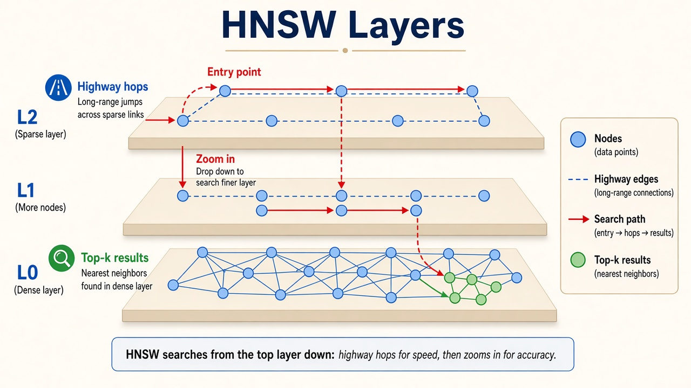
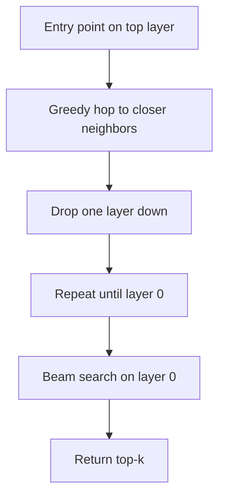
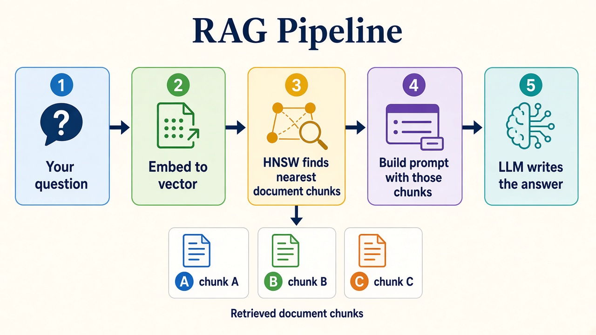
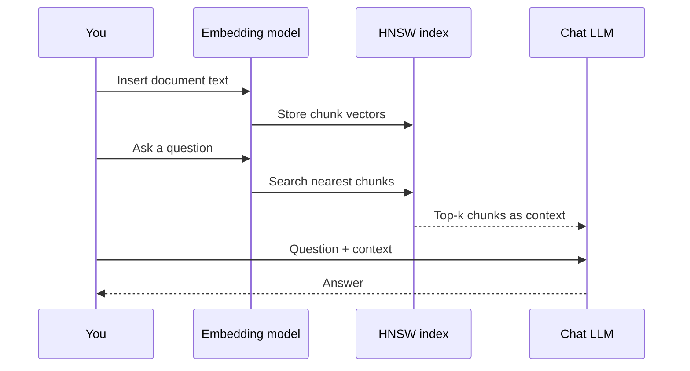
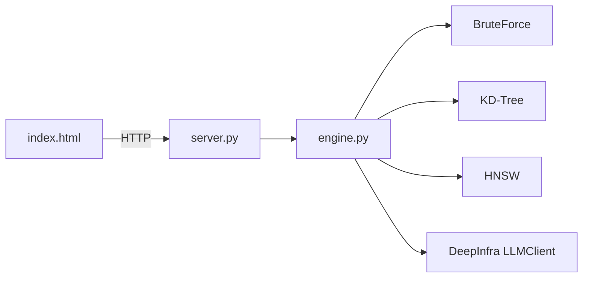

# Flash Vector DB

A beginner-friendly **vector database** built from scratch in Python, with a web UI.

You can search by *meaning* (not just exact keywords), compare three search algorithms live, and ask questions over your own notes with a RAG pipeline.

---

## Start here (30-second picture)

A normal database asks: *“Is there a row with this exact title?”*

A vector database asks: *“Which stored items are closest in meaning to this question?”*



1. Text becomes a **vector** (a list of numbers) through an **embedding** model.
2. Similar ideas land near each other in that number-space.
3. Search finds the nearest neighbors of your query vector.

---

## Table of contents

1. [What you will learn](#what-you-will-learn)
2. [Big idea in one flowchart](#big-idea-in-one-flowchart)
3. [Core concepts (beginner)](#core-concepts-beginner)
4. [Three search algorithms](#three-search-algorithms)
5. [HNSW explained](#hnsw-explained)
6. [RAG explained](#rag-explained)
7. [How to run](#how-to-run)
8. [How to test](#how-to-test)
9. [Project files](#project-files)
10. [API cheat sheet](#api-cheat-sheet)

---

## What you will learn

| Concept | Plain English |
|---|---|
| Embedding | Turn text into numbers that capture meaning |
| Vector | That list of numbers |
| Distance / similarity | How close two vectors are |
| k-NN | “Give me the *k* closest items” |
| Brute Force | Check every item (slow but exact) |
| KD-Tree | Split space into boxes (good in low dimensions) |
| HNSW | Fast graph search used in real vector DBs |
| RAG | Retrieve useful chunks, then let an LLM answer |

---

## Big idea in one flowchart



**Demo Search tab** uses 20 built-in 16D example vectors (CS / Math / Food / Sports).  
**Documents + Ask AI** use real DeepInfra embeddings + chat.

---

## Core concepts (beginner)

### 1) Embedding = meaning → numbers

```text
"puppy naps on the couch"  →  [0.82, 0.05, 0.01, 0.11, ...]
"kitten sleeps on the sofa" →  [0.80, 0.04, 0.02, 0.10, ...]   ← nearby
"rocket flies to the moon"  →  [0.02, 0.01, 0.88, 0.07, ...]   ← far away
```

Same idea → similar numbers. Different idea → different numbers.

### 2) Distance = “how close?”

This project uses **distance** (lower is better):

| Metric | Intuition |
|---|---|
| **Cosine** | Do the arrows point the same way? (great for text) |
| **Euclidean** | Straight-line distance between points |
| **Manhattan** | Distance if you can only move along axes |

Cosine distance here is: `1 − cosine_similarity`.

### 3) k-NN search

Ask for the **k** nearest neighbors. Example: `k = 5` → return the 5 closest stored items.



---

## Three search algorithms





| Algorithm | Exact? | Speed idea | Best for |
|---|---|---|---|
| Brute Force | Yes | `O(N · d)` | Small data / ground truth |
| KD-Tree | Yes | Prunes boxes | Low dimensions (like 16D demo) |
| HNSW | Approximate | ~`O(log N)` | Large / high-d data (real embeddings) |

In the UI, click **COMPARE ALL ALGOS** to see latency side by side.

---

## HNSW explained

**HNSW** = *Hierarchical Navigable Small World*.

Think of a city map with highways (upper layers) and local streets (bottom layer).





**Why interviews love this**

- Upper layers = few long-range links (fast travel)
- Layer 0 = all points + many local links (precision)
- Tunables: `M` (neighbors), `ef_construction` (build quality), `ef` (search quality vs speed)
- Same family of idea used by production systems like Pinecone / Weaviate / Chroma / Milvus

---

## RAG explained

**RAG** = *Retrieval-Augmented Generation*.

The LLM does not magically “know” your PDF. You **retrieve** the useful chunks first, then ask the model to answer using them.





In this project:

1. Text is split into overlapping chunks (250 words, 30 overlap)
2. Each chunk is embedded with DeepInfra `BAAI/bge-base-en-v1.5`
3. Question is embedded the same way
4. HNSW returns the closest chunks
5. DeepInfra chat model (`LLM_MODEL`) writes the answer

---

## How to run

### 1) Install deps

```powershell
cd C:\Users\Abhishek-VM\Desktop\flash_vector_db
python -m pip install -r requirements.txt
```

### 2) Configure DeepInfra (for Documents + Ask AI)

`.env` should look like this (already gitignored):

```env
LLM_API_KEY=your_key_here
LLM_BASE_URL=https://api.deepinfra.com/v1/openai
LLM_MODEL=deepseek-ai/DeepSeek-V4-Flash
EMBED_MODEL=BAAI/bge-base-en-v1.5
```

> Never commit `.env`. Use `.env.example` as a template.

### 3) Start the server

```powershell
python server.py
```

Open: **http://localhost:8080**

You should see something like:

```text
=== VectorDB Engine ===
http://localhost:8080
20 demo vectors | 16 dims | HNSW+KD-Tree+BruteForce
DeepInfra: ONLINE
```

---

## How to test

### A) UI checklist (easiest)

1. **Demo search**
   - Type `binary tree` → **SEARCH**
   - Expect CS results and a glowing point on the scatter plot
2. **Switch algorithms**
   - Try HNSW / KD-TREE / BRUTE
   - Click **COMPARE ALL ALGOS**
3. **Documents**
   - Header badge should say **DEEPINFRA ✓**
   - Paste a short note → **EMBED & INSERT**
4. **Ask AI**
   - Ask a question about that note
   - Confirm answer + context chips appear

### B) Quick API tests

```powershell
# Is DeepInfra connected?
curl http://127.0.0.1:8080/status

# Demo search (CS-like vector)
curl "http://127.0.0.1:8080/search?v=0.9,0.8,0.7,0.6,0.1,0.1,0.1,0.1,0.1,0.1,0.1,0.1,0.1,0.1,0.1,0.1&k=3&metric=cosine&algo=hnsw"

# Insert a document
curl -X POST http://127.0.0.1:8080/doc/insert `
  -H "Content-Type: application/json" `
  -d "{\"title\":\"DP Notes\",\"text\":\"Dynamic programming uses memoization for overlapping subproblems.\"}"

# Ask with RAG
curl -X POST http://127.0.0.1:8080/doc/ask `
  -H "Content-Type: application/json" `
  -d "{\"question\":\"What is dynamic programming?\",\"k\":2}"
```

---

## Project files

```text
flash_vector_db/
├── engine.py         # math + BruteForce + KD-Tree + HNSW + VectorDB + DocumentDB + LLMClient
├── server.py         # Flask API + serves the UI
├── index.html        # search UI, scatter plot, docs, Ask AI
├── docs/             # beginner diagrams used in this README
├── .env.example      # safe template for keys
├── requirements.txt
└── README.md
```



---

## API cheat sheet

### Demo vectors (16D)

| Method | Endpoint | What it does |
|---|---|---|
| `GET` | `/search?v=...&k=5&metric=cosine&algo=hnsw` | Nearest neighbors |
| `POST` | `/insert` | Add a demo vector |
| `DELETE` | `/delete/:id` | Remove by id |
| `GET` | `/items` | List demo items |
| `GET` | `/benchmark?...` | Time all 3 algorithms |
| `GET` | `/hnsw-info` | Graph layer stats |
| `GET` | `/stats` | Counts + options |

### Documents + RAG

| Method | Endpoint | Body |
|---|---|---|
| `POST` | `/doc/insert` | `{"title":"...","text":"..."}` |
| `GET` | `/doc/list` | — |
| `DELETE` | `/doc/delete/:id` | — |
| `POST` | `/doc/ask` | `{"question":"...","k":3}` |
| `GET` | `/status` | DeepInfra + counts |

---

## Interview one-liners

- **Embedding:** text → dense vector that preserves meaning.
- **Vector DB:** stores vectors + finds nearest neighbors fast.
- **Brute Force:** exact, scales poorly.
- **KD-Tree:** axis splits; struggles in high dimensions.
- **HNSW:** multilayer graph; production ANN choice.
- **RAG:** retrieve relevant chunks, then generate with an LLM.

---

## License

MIT
